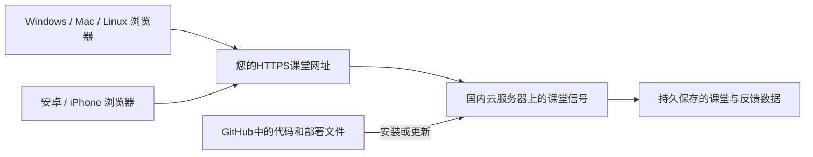

# 从零开始：把“课堂信号”变成师生都能打开的网站

这份说明假设：您主要使用Windows电脑，没有服务器，没有部署经验，准备使用国内云服务器。示例选用腾讯云轻量应用服务器；阿里云等平台也可部署，但购买和控制台按钮不同，不要混用两家的界面步骤。

遇到不一样的页面或红色错误，先停止当前步骤，把不含密码的提示文字告诉我，再继续。不要一遍遍重复点击购买，也不要将服务器密码、GitHub令牌或 `.env` 内容发到聊天。

## 先认识三个东西

| 名称 | 可以这样理解 | 您需要做什么 |
| --- | --- | --- |
| GitHub仓库 | 放置网站程序和说明书的文件柜 | 打开 https://github.com/SXNUHyx/mathSXNU 查看 |
| 云服务器 | 一台由云公司保管、一直开机的电脑 | 在自己的云账号购买并管理 |
| 域名 | 网站的门牌号，例如您自己拥有的课堂子域名 | 准备实际域名并指向服务器 |

GitHub里有代码，和学生能打开一个教学网站，是两件事。当前程序需要保存课堂和反馈，不能只打开GitHub Pages就完成上线。



“服务器使用Ubuntu”和“您的电脑使用Windows”没有冲突。老师、学生都不用安装Ubuntu或编程软件；各自用浏览器即可。

## 第0步：先检查GitHub里的文件

1. 用自己的电脑浏览器打开 https://github.com/SXNUHyx/mathSXNU 。
2. 找到左上方分支按钮，选择 `main`。
3. 正常应看到 `README.md`、`Dockerfile`、`compose.yaml`、`deploy`、`scripts`、`docs` 等文件。
4. 点击 `docs`，再点击本教程，即可在GitHub上阅读全部步骤。

看到这些文件说明代码已在该分支。若仍只有一个很短的README，先刷新页面、检查分支，再确认上传结果，不要继续买服务器来“解决”文件缺失。

## 第1步：注册云账号，先不购买

1. 打开 https://cloud.tencent.com/ 。
2. 点击登录或注册，按平台提示完成账号注册和实名认证。
3. 搜索产品“轻量应用服务器”，进入它的产品页面或控制台。
4. 先查看有没有学校提供的资源、已有优惠或可使用的学校域名。不要把“域名”“数据库”“对象存储”等多个产品一并购买。

**本步骤完成标志：**您能登录腾讯云控制台，并找到“轻量应用服务器”。实名认证由您本人在官方平台完成，我不代填身份或支付信息。

## 第2步：确定域名与备案，再选服务器

学校若能提供一个课堂子域名，优先使用；需要学校的域名管理人员配合解析，是否需要新增或变更备案由学校及服务商确定。

若准备自己注册域名：

1. 在云平台搜索“域名注册”，选择一个可注册的 `.cn` 或 `.com` 名称。
2. 查看首次价格和下一年的续费价格，再决定是否购买。域名与服务器通常分别计费。
3. 按官方流程完成域名实名认证。注册完成不等于已完成ICP备案。
4. 进入云平台“网站备案 / ICP备案”说明，先检查拟购买的服务器是否符合备案条件及所需购买时长；部分产品有最低时长要求，以当时官方说明为准。
5. 大陆服务器正式对外提供网站，一般需要按服务商流程办理ICP备案；涉及学校名义、网站名称和主体资格时先与学校确认。不要使用示例域名申请，不承诺备案完成天数。

**本步骤完成标志：**明确将使用的真实课堂域名、备案办理方式和允许购买的服务器方案。备案等待时可以准备程序；未满足开站要求前不组织真实学生对外访问。

## 第3步：购买一台合适的服务器

在“轻量应用服务器”购买页面按下表核对。实际按钮名称和价格可能随平台调整。

| 设置项 | 本教程使用的选项 |
| --- | --- |
| 地区 | 中国大陆、与学生较近且学校允许的地区 |
| 镜像类型 | 纯操作系统 / 系统镜像 |
| 操作系统 | **Ubuntu 24.04 LTS，x86_64** |
| 配置起点 | 2核CPU、4GB内存、至少40GB磁盘 |
| 公网网络 | 有可访问的公网IPv4地址；流量和带宽按班级规模估算 |
| 购买时长 | 按备案资格、预算与试点安排确定，付款前看清续费价格 |

本教程没有要求购买Windows服务器，也不要求额外购买独立云数据库。不要选择WordPress等其他应用镜像来照做这份教程。

**本步骤完成标志：**控制台出现一台状态为“运行中”的服务器，系统显示Ubuntu 24.04，详情里能找到公网IP。

## 第4步：找到“浏览器里的黑色窗口”

1. 在云控制台进入这台服务器的详情页。
2. 点击“登录”或“远程登录”，选择平台提供的浏览器登录方式（可能称为OrcaTerm）。
3. 按官方提示设置或使用服务器登录凭据。它与稍后创建的“教师账号”不是同一个账号。
4. 登录后会看到能输入文字的窗口。下文把它叫作“服务器终端”。

接下来的服务器命令，都粘贴到这个窗口里，**不是在Windows的搜索框里输入，也不是在GitHub网页里输入**。

点击代码框的复制按钮，粘贴到终端后按一次Enter。复制命令时不要带上前后的三个反引号。多行命令一组一组执行，上一组成功后再执行下一组。

## 第5步：安装服务器所需工具

在服务器终端输入：

```bash
sudo apt-get update
sudo apt-get install -y docker.io docker-compose-v2 git python3
sudo systemctl enable --now docker
sudo docker compose version
```

如果要求输入服务器用户密码，输入时屏幕不显示字符属于正常情况，输入完按Enter。

**成功标志：**最后显示Docker Compose版本，且没有 `command not found`、`Unable to locate package` 等错误。安装提示很多正常；如果这一组失败，停在这里，不要更改到来历不明的软件源。

这些安装命令面向Ubuntu 24.04；尚未在您未来购买的真实服务器上执行。若系统不同，先调整方案。

## 第6步：从GitHub把程序放到服务器

```bash
sudo git clone https://github.com/SXNUHyx/mathSXNU.git /opt/mathsxnu
cd /opt/mathsxnu
ls
```

**成功标志：**最后列出 `Dockerfile`、`compose.yaml`、`manage.py`、`scripts` 等文件。

若提示 `/opt/mathsxnu` 已存在，不要删除它；可能之前已经成功下载。先执行 `cd /opt/mathsxnu` 和 `ls` 检查。

若仓库是私有的，服务器可能没有GitHub读取权限。若出现登录提示、403或认证错误，请停下来，我会指导配置只读部署访问；不要把GitHub账号密码粘进命令，不要为了省一步而擅自公开仓库。

若国内服务器访问GitHub或Docker官方源超时，先保留具体报错；可以评估学校认可的镜像仓库或离线交付方式，不关闭TLS验证，也不使用未知网站搬运程序。

## 第7步：把域名指向服务器

在域名服务商控制台找到“域名解析”，添加一条记录。假设您已有一个域名，准备给课堂使用它下面的 `classroom` 子域名：

| 字段 | 怎么填 |
| --- | --- |
| 记录类型 | A |
| 主机记录 | classroom |
| 记录值 | 第3步看到的服务器公网IPv4地址 |
| TTL | 保持默认即可 |

这样得到的课堂网址就是 `classroom.您自己的域名`。如果学校提供的是已有子域名，具体解析请让学校管理人员处理。

进入云服务器“防火墙 / 安全组”页面：允许网站所需的TCP **80** 和 **443** 端口；SSH登录的22端口优先按控制台说明限制到自己的管理来源。不要开放所有端口，不需要开放8000或数据库端口。

在服务器终端可以检查：

```bash
python3 -c "import socket; print(socket.gethostbyname(input('请输入课堂域名，不带https://：').strip()))"
```

**成功标志：**输入真实课堂域名后，显示的IP与服务器公网IP一致。解析有传播时间；若不一致，先检查解析，不要反复重装程序。

## 第8步：告诉程序您使用哪个域名

回到服务器终端：

```bash
cd /opt/mathsxnu
sudo python3 scripts/configure-deployment.py
```

看到提示后，输入第7步准备好的真实课堂域名，例如您自己的课堂子域名，**不要加 `https://`，不要输入教学示例域名**。

程序会自动生成私有的 `.env` 文件和随机密钥。您不用手工生成或记忆密钥，也不要把这个文件上传GitHub。若提示已有配置，说明它没有覆盖原设置；需要更改时告诉我。

**成功标志：**显示“已生成私有配置”，没有红色错误。

## 第9步：启动网站

```bash
cd /opt/mathsxnu
sudo docker compose up -d --build
sudo docker compose ps
```

首次会下载软件，可能需要几分钟。`-d`表示程序在后台运行，关闭浏览器终端后仍能继续运行。

**成功标志：**`web`状态为运行中，并在健康检查完成后显示 `healthy`；`gateway`也在运行。刚启动时显示 `starting` 可稍等后再执行 `sudo docker compose ps`。

如果没有成功，可执行下列命令查看错误：

```bash
sudo docker compose logs --tail=60 web gateway
```

确认日志不包含个人信息、密码和密钥后，再把错误片段告诉我。不用执行 `docker compose config` 来排错，它可能把密钥展开显示出来。

域名解析、80/443端口和备案等前提满足时，gateway会自动申请HTTPS证书。若证书失败，先检查域名、端口与服务商限制，不使用忽略证书警告的方式组织学生访问。

## 第10步：创建您自己的教师账号

```bash
cd /opt/mathsxnu
sudo docker compose exec web python manage.py createsuperuser
```

终端会逐项询问：

1. `Username`：填写您容易记住的教师用户名，例如自选的字母组合。
2. `Email address`：按需要填写，可留空后按Enter。
3. `Password`：设置教师登录密码，输入时屏幕不显示内容。
4. `Password (again)`：再次输入同一个密码。

如果提示密码太常见或太短，重新设置一个更强的密码，不要绕过检查。

**成功标志：**显示教师用户创建成功。这个账号用于网站，不是云平台账号，也不是学生账号。

## 第11步：用Windows电脑打开教师端

1. 打开Edge或Chrome等更新过的浏览器。
2. 在顶部地址栏输入 `https://` 加您的真实课堂域名，按Enter。
3. 看到“课堂信号”首页后，点击右上角“教师登录”。
4. 输入第10步设置的教师用户名和密码。
5. 点击“创建课堂”，填写课程名称和本次知识点，例如“高等数学”“连续与可导的关系”。
6. 创建成功后会看到教师看板、二维码和6位课堂码。

页面使用HTTPS、没有证书警告，才进入正式使用检查。

## 第12步：用安卓手机完成第一次学生反馈

先由您自己扮演一名学生测试，不必马上通知全班：

1. 安卓手机打开更新过的Chrome、Edge或兼容的系统浏览器。
2. 打开同一个课堂网址，输入老师看板上的6位课堂码；也可以扫描二维码后选择在浏览器打开。
3. 选择“需要帮助”，在补充说明里写一句测试内容。
4. 点击“把信号送给老师”。
5. 看Windows电脑的教师看板，约5秒后应出现一份红色反馈。
6. 在手机改选“听懂了”，点击“更新我的反馈”。
7. 看电脑，反馈总数应仍为1，绿色变为1。
8. 教师点击“结束本次收集”，手机刷新后应显示课堂已结束，不能继续修改。

您也可以用iPhone的Safari、Mac或Linux电脑的现代浏览器重复检查。两端均为网页，不需要为每个操作系统安装独立应用。老旧Internet Explorer不在支持范围。学习通内置浏览器若打开异常，请复制链接到系统浏览器。

**完成标志：**电脑和实际手机都通过上述流程。这才是“师生可以使用”，仅看到GitHub文件或服务器运行中还不算。

## 第13步：每天保护数据

在服务器终端运行：

```bash
cd /opt/mathsxnu
sudo bash scripts/backup-server.sh
```

程序会将数据库备份到服务器的 `/opt/mathsxnu/backups/`。通过云控制台支持的安全文件下载方式，将备份下载到另一台设备妥善保存；如果找不到文件下载入口，告诉我当前控制台名称再按实际界面操作。

不要把数据库、备份、学生留言、教师密码或 `.env` 上传GitHub。仓库有忽略规则，但自己手动上传文件时仍应留意。

保持服务器和域名续费，指定维护联系人。后续可以添加定时备份，不把“手动备份脚本存在”说成已设置每日自动备份。

## 以后更新程序

普通代码更新可按下面执行；涉及数据库结构升级时先由维护者检查说明：

```bash
cd /opt/mathsxnu
sudo bash scripts/backup-server.sh
sudo git pull --ff-only origin main
sudo docker compose up -d --build
sudo docker compose ps
```

若 `git pull` 提示冲突或本地改动，停止操作并保留提示，不执行强制覆盖。

**不要执行 `docker compose down -v`**：其中 `-v` 会删除持久数据卷。正常更新只用上面的命令，不删除数据卷。

## 目前验证了什么，没有验证什么

项目本地已进行Django功能/权限测试、桌面和手机尺寸的Chromium浏览器验证；Docker构建与部署文件的具体验证结果见项目交付说明。GitHub Actions另配置了Linux、Windows、macOS的自动测试，但必须查看实际运行结果才能说三系统测试通过。

真实Windows/安卓/iPhone设备、您的校园网络、国内服务器访问上游软件源、域名证书与备案情况，都需要按本教程在您自己的环境核验。不能把手机尺寸模拟测试当成所有系统实机认证。

第一版只收集浏览器会话的不记名反馈；换浏览器、清理Cookie可能重复计数，不作为严格考勤或成绩依据。
